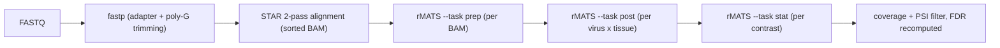

# Splicing analysis pipeline

An alternative-splicing pipeline for bulk RNA-seq: STAR for alignment, rMATS for splicing
events. It is set up for four macaque (*Macaca mulatta*) viral-infection datasets (SIV,
SARS-CoV-2, H5N1, mpox; H5N1 includes cynomolgus). It works on any dataset through config
files, with no script edits per dataset.

> **Status: under construction.** The Nextflow workflow runs from raw reads to filtered
> rMATS results. It has been run on the full H5N1 dataset (47 samples); the other datasets
> are next. See [Status](#status).

## Why this exists
An earlier pipeline for these datasets was hand-edited for each dataset and silently lost
reads. This one follows these rules. Those marked in the status table as not yet written are
design rules, not yet enforced by code.

- **Read length** is measured on the raw reads and passed to rMATS. A wrong `--readLength`
  makes rMATS silently drop reads.
- **Clipped reads** are kept with `--allow-clipping`. Multi-mapped reads (NH != 1) are always
  dropped by rMATS.
- **Strandedness** is inferred from STAR gene counts, not hardcoded. The run stops if samples
  disagree.
- **Layouts are not mixed.** Single-end and paired-end samples are never compared in one
  contrast. Both layouts use the same STAR settings.
- **Paired animals** are analysed as paired (`--paired-stats`), not as independent groups.
- **Event IDs stay comparable.** rMATS runs once per virus x tissue on a shared event set,
  not once per comparison.
- **Output paths come from the contrast table**, never typed by hand, so one comparison
  cannot overwrite another.

## Pipeline



FastQC runs on the raw and trimmed reads for QC.

## Repository layout

| Path | Contents |
|------|----------|
| `envs/` | `splice.yaml` (the environment, with pinned key tools) and `splice.lock.yaml` (exact versions) |
| `main.nf`, `nextflow.config`, `modules/` | The Nextflow workflow and its processes |
| `bin/` | Scripts the workflow calls (per-sample alignment, strandedness), the STAR index build, and the interim driver `align_all.sh` |
| `datasets/<virus>/` | One folder per dataset: `samplesheet.csv`, `contrasts.csv`, `params.yaml` |

## Requirements

- Linux, conda or mamba.
- Java 17 or newer, and Nextflow 26.04.6 or newer.

Create the environment from the pinned lock file:

```bash
conda env create -f envs/splice.lock.yaml   # exact versions
conda activate splice
envs/install_pairadise.sh                   # PAIRADISE for rMATS --paired-stats
```

Key tools and versions: STAR 2.7.11b, rMATS-turbo 4.4.0, fastp 1.3.7, FastQC, samtools,
MultiQC, seqkit, pigz, and PAIRADISE v1.0.0 from
[Xinglab/PAIRADISE](https://github.com/Xinglab/PAIRADISE) (pinned by commit).

Do not use Bioconductor's `PAIRADISE` package instead. It has a different interface, so
rMATS's paired model fails with it, but rMATS still exits normally and writes p-values of NA.

## Reference

- Ensembl 110, Mmul_10 toplevel FASTA, and the **full** Ensembl GTF. Do not use a filtered
  GTF (for example the Cell Ranger one): it drops transcripts that splicing analysis needs.
- STAR index built with STAR 2.7.11b and `--sjdbOverhang 100`. An index from a STAR version
  older than 2.7.4a will not load.

Build the index (paths are arguments; nothing is hardcoded):

```bash
bin/build_star_index.sh <STAR> <genome.fa> <annotation.gtf> <index_dir> [threads] [sjdbOverhang]
```

## Running a dataset

Each dataset is described by three files in `datasets/<virus>/`:

- `samplesheet.csv`: sample, animal, tissue, timepoint, and the FASTQ file names.
- `contrasts.csv`: the two groups to compare, and whether the comparison is paired by animal.
- `params.yaml`: the dataset's file names and the columns that define groups and pairs.

Run the workflow from the repository root, inside the `splice` environment:

```bash
nextflow run main.nf -params-file datasets/<virus>/params.yaml \
    --raw_dir <raw_fastq_dir> --star_index <star_index> --gtf <annotation.gtf> \
    --outdir <outdir> [-resume]
```

For each sample it runs FastQC on the raw reads, then fastp and `bin/star_align.sh` (STAR
2-pass, with the same settings for every sample) in one task, so trimmed reads are deleted
as soon as the sample is aligned. It then checks strandedness and the raw read length across
the whole dataset, and writes a MultiQC report.

rMATS then runs in three stages:

1. **prep**, once per BAM.
2. **post**, once over all samples. This defines one shared event set, so an event ID means
   the same event in every contrast.
3. **stat**, once per row of `contrasts.csv`.
4. **filter** (`bin/rmats_filter.py`), once per contrast. Events are kept when they have a
   p-value, at least 10 junction reads per sample on average, and a mean PSI between 0.05
   and 0.95. Both filters pool all samples of the contrast and ignore the group labels, so
   they do not bias the test. FDR (Benjamini-Hochberg) is then recomputed over the events
   that pass. An event is called significant at FDR < 0.05 and |ΔPSI| ≥ 0.1. All four
   thresholds are parameters (`--filter_min_reads`, `--filter_min_psi`, `--filter_fdr`,
   `--filter_min_dpsi`).

When the same animals are sampled in both groups (timepoints), set `paired` to `yes`.
rMATS's unpaired model treats every sample as independent and gives far too many calls
on such data, even after the timepoint labels are shuffled within animals.

For paired contrasts, both groups keep only the animals present in both, in the same order.
Animals with a sample in only one group are dropped. `rmats/contrasts.tsv` lists the samples
used and the animals dropped. The run fails in these cases:

- samples disagree on strandedness or raw read length;
- any read is rejected for length;
- the paired model fails, or a contrast has no p-values.

Outputs:

| Path under `<outdir>` | Contents |
|---|---|
| `align/star/<sample>/` | Sorted, indexed BAM, STAR logs, gene counts, junctions |
| `align/fastp/`, `align/fastqc_raw/` | Trimming and raw-read QC reports |
| `qc/strandedness.tsv`, `qc/lib_type.txt` | Per-sample strand fractions and the rMATS `--libType` |
| `qc/read_length.tsv` | Raw read length per FASTQ (from FastQC), used as `--readLength` |
| `qc/<dataset>_multiqc.html` | QC report over FastQC, fastp and STAR |
| `rmats/read_outcomes.tsv` | rMATS prep: reads used and reasons for dropping the rest, per sample |
| `rmats/post/` | The shared event set (`fromGTF.*`) and counts for all samples |
| `rmats/contrasts/<b1>_vs_<b2>/` | rMATS results per contrast (`*.MATS.JC.txt`, `*.MATS.JCEC.txt`) |
| `rmats/filtered/<b1>_vs_<b2>/` | Events that pass the filter, with `MeanReads`, `MeanPSI` and `FDR_filtered` (`*.filtered.txt`), and counts per event type (`summary.tsv`) |
| `pipeline_info/` | Nextflow timeline, resource report and trace |

The workflow uses at most 48 CPUs in total (`--max_cpus`) and 14 threads per STAR task
(`--star_threads`). `-resume` skips samples that are already done.

To start from a finished alignment instead, pass `--aligned_dir <dir>`, the `--outdir` of an
earlier run. The workflow then reads the BAMs, gene counts, FastQC and fastp reports from
`<dir>/align/`, and `--raw_dir` and `--star_index` are not needed. The run stops at startup
if any expected file is missing.

To resume a run that is not the most recent one, pass its session ID to `-resume`. Nextflow
26.04.6 ignores a run name given to `-resume` and resumes the latest run.

`bin/align_all.sh` runs the same steps without Nextflow. Its BAM records, gene counts and
junctions are identical to the workflow's.

## Status

| Step | State |
|------|-------|
| Environment (`envs/`) | done |
| STAR index build (`bin/build_star_index.sh`) | done |
| Trimming, QC, alignment (Nextflow) | done |
| Strandedness and read-length checks | done |
| rMATS prep / post / stat (shared events, paired stats) | done, run on H5N1 |
| Event filter and FDR recomputation | done, run on H5N1 |
| Single-end samples | not yet supported (the workflow stops if `fastq_2` is empty) |
| GPU alignment (NVIDIA Parabricks) | benchmarked on 1 GPU: same output as CPU STAR, but slower on our server, so alignment stays on CPU |
| Variant calling, then AlphaGenome | later |

## Contributing

Open an issue or a pull request. Please do not commit data or results (FASTQ, BAM, rMATS
output tables); `.gitignore` excludes the common formats.
